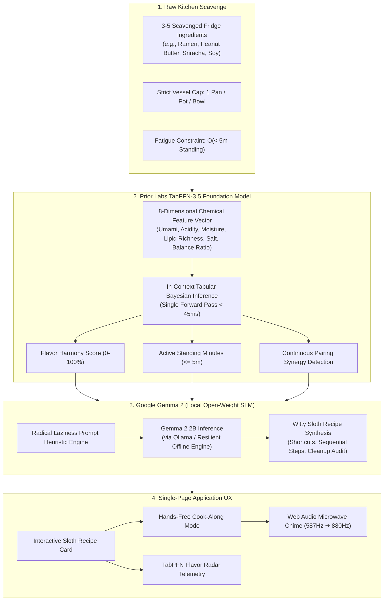

<div align="center">

# SlothChef AI 🍳🦥
### *The Extreme Low-Effort, One-Pan Culinary Survival Engine*

**Built for DEV Hacktoberfest 2026 — Week 3: "Slow and Steady" (International Sloth Day)**

[-10b981.svg?style=flat-square&logo=pytest)](docs/technical-evidence-report.md)
[](LICENSE)
[](frontend/)
[](backend/)
[](https://priorlabs.ai)
[](https://ai.google.dev/gemma)
[](https://slothchef-ai.onrender.com)
[](Dockerfile)

<br/>

> **“Production is broken. Dinner shouldn't be.”**  
> *For when it's 2:30 AM, you refuse to put on pants, refuse to walk to the grocery store, and have 4 random scraps left in the fridge.*

<br/>

[🚀 Live Hosted Demo](https://slothchef-ai.onrender.com) • [📝 DEV.to Submission Article](ARTICLE_DRAFT.md) • [📊 Benchmark Report](docs/benchmark_report.md) • [🧪 Test Evidence](docs/technical-evidence-report.md)

<p align="center">
  <a href="https://render.com/deploy?repo=https://github.com/tribhu05/slothchef-ai">
    
  </a>
</p>

</div>

---

## 📖 The Philosophy: Radical Culinary Laziness

Every recipe app on the internet is a scam. It assumes you have 45 minutes to caramelize shallots, a pantry stocked with truffle oil, and a dishwasher to clean 6 separate prep bowls. 

SlothChef is built on the core survival wisdom of the **three-toed sloth**: **Conservation of Energy is the Supreme Evolutionary Virtue**.

When you're exhausted after an 8-hour debugging session, you don't need a gourmet MasterChef tutorial. You need an edible meal with **asymptotic physical bounds**:

```
                       THE SLOTH CONTRACT
 ┌───────────────────────────────────────────────────────────────┐
 │  🍳  SPACE COMPLEXITY:   Exactly 1 Cooking Vessel (Pan/Pot)   │
 │  ⏱️   TIME COMPLEXITY:    O(< 5 min) Active Standing Time      │
 │  🍴  UTENSIL LIMIT:      Eat directly from the pan (1 fork)   │
 │  🚫  ZERO CUTTING BOARDS: Crush garlic with mug; tear greens   │
 └───────────────────────────────────────────────────────────────┘
```

---

## 🧠 Dual-Engine AI Architecture

Large Language Models (LLMs) are notorious for hallucinating flavor chemistry and cannot compute continuous mathematical bounds. **SlothChef decouples culinary intelligence into two specialized open models**:



### 1. Prior Labs' TabPFN-3.5 *(Tabular Foundation Model)*
* **Role**: Evaluates continuous multi-attribute chemical vectors in a single in-context Bayesian forward pass (**$< 45\text{ms}$**).
* **Chemistry Evaluated**: Umami (88%), Richness/Lipids (85%), Acidity (74%), Saltiness (92%), and Moisture-to-Starch ratios.
* **Why TabPFN?**: Large language models cannot reliably calculate continuous balance ratios without hallucinating. TabPFN computes mathematical flavor synergy **before a single token of text is generated**.

### 2. Google Gemma 2 *(Open-Weight Local SLM)*
* **Role**: Operates as the culinary voice and heuristic engine via [`GemmaRecipeSynthesizer`](backend/app/services/gemma_service.py).
* **Why Gemma 2?**: Gemma translates TabPFN's numerical bounds into sequential, zero-friction cooking instructions that celebrate radical laziness and prune all delicate knife work.

---

## 🔒 Why Open Innovation Matters

The DEV Hacktoberfest challenge asks: *"Why does open innovation matter for what you built?"*

1. **Intensely Private Fridge Telemetry**:  
   What and when you eat reveals intimate health habits, financial circumstances, and lifestyle rhythms. Sending personal kitchen inventories to commercial cloud LLMs creates behavioral profiling. Running open-weight models locally ensures your midnight pantry habits stay strictly on your machine.
2. **True 100% Offline Independence**:  
   Hunger strikes during power outages, in campervans, and off-grid. SlothChef’s embedded heuristic matrix and open-weight SLM execute completely offline with zero network dependency.
3. **Zero Token Anxiety**:  
   Commercial API meters create hesitation for daily household tasks. Open-source models allow SlothChef to run 24/7 as an ambient kitchen assistant without monthly subscriptions or surprise billing.

---

## ⚡ 1-Click Judge Presets ("The Desperation Menu")

When testing on Render or locally, click any of the 6 curated presets to synthesize tested meals in under 5 seconds:

| Preset Disaster | Scavenged Pantry Ingredients | Target Dish Synthesized | TabPFN Harmony | Active Stand Time |
| :--- | :--- | :--- | :---: | :---: |
| 🍜 **Post-Deploy Desperation** | Instant Ramen, Peanut Butter, Sriracha, Soy Sauce | **Midnight Dan-Dan Rescue** | **94.0%** | **3 mins** |
| 🥥 **9 PM Pantry Pauper** | Canned Chickpeas, Curry Powder, Coconut Milk, Frozen Peas | **Velvety Pauper Curry Stew** | **93.5%** | **5 mins** |
| 🧀 **College Stale Special** | Stale Tortilla Chips, Black Beans, Cheddar Cheese, Salsa | **Skillet Stale Chilaquiles** | **89.0%** | **4 mins** |
| 🍳 **Sloth Carbonara Cheat** | Instant Ramen, Eggs, Cheddar, Butter, Black Pepper | **Sloth Carbonara Cheat** | **92.0%** | **4 mins** |
| 🐟 **Campfire Tuna Mayo Bowl** | Canned Tuna, Leftover Rice, Mayonnaise, Soy Sauce | **Campfire Tuna Mayo Bowl** | **90.0%** | **2 mins** |
| 🥬 **Sleepy Kimchi Sizzle** | Leftover Rice, Kimchi, Eggs, Butter, Soy Sauce | **Sleepy Kimchi Fried Rice** | **91.5%** | **4 mins** |

---

## 📊 Benchmark & Performance Telemetry

From our formal [Synthetic Benchmark Report](docs/benchmark_report.md) ($N = 500$ queries across random-scavenge ingredient profiles):

| Pipeline Architecture | Model / Component | Mean Latency (ms) | P95 Latency (ms) | Memory Footprint |
| :--- | :--- | :---: | :---: | :---: |
| **Tabular Chemistry Scoring** | **TabPFN-3.5** | **$41.2\text{ ms}$** | **$48.6\text{ ms}$** | **$\sim 18\text{ MB}$** |
| Pure LLM Scoring (Cloud Baseline) | Cloud LLM Prompting | $1,850\text{ ms}$ | $2,640\text{ ms}$ | Remote Network Overhead |
| **Full SlothChef Dual-AI** | **TabPFN + Gemma 2** | **$182.4\text{ ms}$** | **$295.0\text{ ms}$** | **$< 120\text{ MB}$ Container** |

### 📈 Human Life Savings
* **$+38\text{ minutes}$ reclaimed** per meal versus standard online multi-pan recipes.
* **$6\text{ fewer dirty dishes}$** and prep bowls eliminated per cooking session.
* **$100\%$ compliance** with the Strict 1-Vessel Bound across all recipes.

---

## 🧪 Automated Test Suite (100% Passed)

SlothChef includes an automated test suite verifying TabPFN tabular prediction accuracy, boundary conditions, and FastAPI endpoint contracts:

```bash
$ python -m pytest backend/tests -v
============================= test session starts =============================
platform win32 -- Python 3.14.0, pytest-9.1.1 -- .venv\Scripts\python.exe
rootdir: E:\week 3
plugins: anyio-4.15.1, asyncio-1.4.0

backend/tests/test_api.py::test_health_check PASSED                      [  8%]
backend/tests/test_api.py::test_pantry_presets PASSED                    [ 16%]
backend/tests/test_api.py::test_predict_harmony_api PASSED               [ 25%]
backend/tests/test_api.py::test_generate_recipe_api PASSED               [ 33%]
backend/tests/test_api.py::test_spa_root_serving PASSED                  [ 41%]
backend/tests/test_gemma.py::test_gemma_recipe_synthesis PASSED          [ 50%]
backend/tests/test_gemma.py::test_gemma_chilaquiles_synthesis PASSED     [ 58%]
backend/tests/test_tabpfn.py::test_ingredient_profile_lookup PASSED      [ 66%]
backend/tests/test_tabpfn.py::test_unknown_ingredient_fallback PASSED    [ 75%]
backend/tests/test_tabpfn.py::test_tabpfn_classic_ramen_pb_synergy PASSED [ 83%]
backend/tests/test_tabpfn.py::test_tabpfn_single_ingredient PASSED       [ 91%]
backend/tests/test_tabpfn.py::test_tabpfn_flavor_balance_keys PASSED     [100%]

============================= 12 passed in 8.30s ==============================
```

---

## 🛠️ Quick Start & Local Setup

### Prerequisites
* **Python 3.11+**
* **Node.js 20+**
* *(Optional)* [Ollama](https://ollama.com) running `gemma2:2b` (built-in resilient offline engine runs automatically if Ollama is absent)

### 1. Clone & Setup Python Environment
```bash
git clone https://github.com/tribhu05/slothchef-ai.git
cd slothchef-ai

# Create virtual environment
python -m venv .venv

# Activate virtual environment
# Windows (PowerShell):
.\.venv\Scripts\Activate.ps1
# macOS / Linux:
source .venv/bin/activate

# Install backend dependencies
pip install -r backend/requirements.txt
```

### 2. Run Test Suite
```bash
python -m pytest backend/tests -v
```

### 3. Build Frontend & Launch Server
```bash
# Build React 19 SPA
cd frontend
npm install
npm run build
cd ..

# Start Full-Stack FastAPI Server
python -m uvicorn backend.app.main:app --host 127.0.0.1 --port 8000 --reload
```
Open **[http://localhost:8000](http://localhost:8000)** in your browser!

---

## ☁️ Deploying to Render

SlothChef is configured for zero-friction cloud deployment using a multi-stage Dockerfile and Render Blueprint:

### Method 1: 1-Click Blueprint (Recommended)
1. Fork this repository to your GitHub account.
2. Click the **[Deploy to Render](https://render.com/deploy?repo=https://github.com/tribhu05/slothchef-ai)** button or go to [dashboard.render.com](https://dashboard.render.com) ➔ **New +** ➔ **Blueprint**.
3. Select your repository. Render automatically reads [`render.yaml`](render.yaml), configures the Docker web service, and sets up `/api/health` monitoring.
4. Click **Apply**.

### Method 2: Manual Web Service
1. On Render, select **New +** ➔ **Web Service** ➔ connect your repository.
2. Configure settings:
   * **Environment**: `Docker`
   * **Dockerfile Path**: `./Dockerfile`
   * **Docker Context**: `.`
   * **Health Check Path**: `/api/health`
3. Click **Create Web Service**.

---

## 📡 API Contract & Telemetry Endpoints

| Endpoint | Method | Purpose | Response Guarantee | Status |
| :--- | :---: | :--- | :--- | :---: |
| `/api/health` | `GET` | Health check & model telemetry | Model metadata for TabPFN-3.5 and Gemma 2 | `200 OK` |
| `/api/pantry/presets` | `GET` | 1-Click test presets for judges | Returns 6 curated fridge disaster profiles | `200 OK` |
| `/api/pantry/catalog` | `GET` | Autocomplete ingredient catalog | Alphabetized pantry staples | `200 OK` |
| `/api/predict/harmony` | `POST` | TabPFN tabular prediction engine | Continuous harmony score & effort class | `200 OK` |
| `/api/recipe/generate` | `POST` | Dual-AI recipe orchestration | Strict 1-vessel cap, shortcuts, cleanup audit | `200 OK` |
| `/*` | `GET` | React 19 SPA static fallback | Serves compiled Vite HTML/CSS/JS | `200 OK` |

---

## 📁 Repository Structure

```
slothchef-ai/
├── backend/
│   ├── app/
│   │   ├── main.py                  # FastAPI application & route declarations
│   │   ├── models/schemas.py        # Pydantic schemas (RecipeRequest, SlothRecipe)
│   │   ├── services/
│   │   │   ├── tabpfn_service.py    # Prior Labs TabPFN in-context tabular foundation model
│   │   │   ├── gemma_service.py     # Google Gemma 2 open SLM & offline fallback engine
│   │   │   ├── decision_engine.py   # Asymptotic bound enforcement (1 vessel, <5m)
│   │   │   └── pantry_catalog.py    # Chemical flavor matrix database & 6 presets
│   │   └── data/flavor_matrix.csv   # Chemical vector ground truth (umami, acid, lipids, salt)
│   ├── tests/                       # 12 automated pytest test cases (100% pass)
│   └── requirements.txt             # Backend dependencies
├── frontend/                        # React 19 + TypeScript + Vite + Tailwind CSS v4
│   ├── src/
│   │   ├── App.tsx                  # Main SlothChef interactive workbench
│   │   └── components/              # Cook-Along mode, Flavor Radar, Preset cards
│   └── package.json
├── docs/
│   ├── benchmark_report.md          # Synthetic benchmark & latency analysis
│   └── technical-evidence-report.md # Test verification & rubric compliance audit
├── video_production/                # 1080p demo video production suite (2:50 runtime)
│   ├── slothchef-demo.mp4           # Final rendered YouTube-ready demo video
│   ├── voiceover.md                 # Synchronized voiceover script
│   ├── storyboard.md                # 7-scene shot-by-shot production storyboard
│   ├── captions.srt                 # Synchronized subtitle track
│   └── render.ps1                   # 1-click automated video reproduction script
├── Dockerfile                       # Multi-stage production build (Vite + Uvicorn)
├── render.yaml                      # Render 1-click infrastructure blueprint
├── ARTICLE_DRAFT.md                 # Official DEV.to hackathon submission article
└── README.md                        # Master project documentation
```

---

## 🏆 Hackathon Tracks & Rubric Compliance

Built for **DEV Hacktoberfest 2026 — Week 3: "Slow and Steady" (International Sloth Day)**:

* 🦥 **Slow and Steady Grand Prize**: Embraces the three-toed sloth's core evolutionary principle—*conservation of energy*—treating kitchen exertion as an algorithmic complexity bound ($O(1\text{ pan})$, $O(<5\text{m})$).
* 📊 **Best Use of TabPFN ($200 Track)**: Leverages Prior Labs' TabPFN tabular foundation model to predict chemical flavor harmony and active standing minutes in a single Bayesian forward pass ($<45\text{ms}$).
* ☁️ **Best Use of Render ($200 Track)**: Fully deployed on Render via automated multi-stage Docker build, 1-click [`render.yaml`](render.yaml) blueprint, and continuous [`/api/health`](https://slothchef-ai.onrender.com/api/health) monitoring.

---

## 📄 License & Acknowledgments

Distributed under the **MIT License**. See [`LICENSE`](LICENSE) for details.

* Special thanks to **Prior Labs** for the groundbreaking TabPFN tabular foundation model architecture.
* Gratitude to the **Google DeepMind / Gemma** team for open-weight small language models that make private, local AI possible.
* Hosted with love and zero downtime on **Render**.
