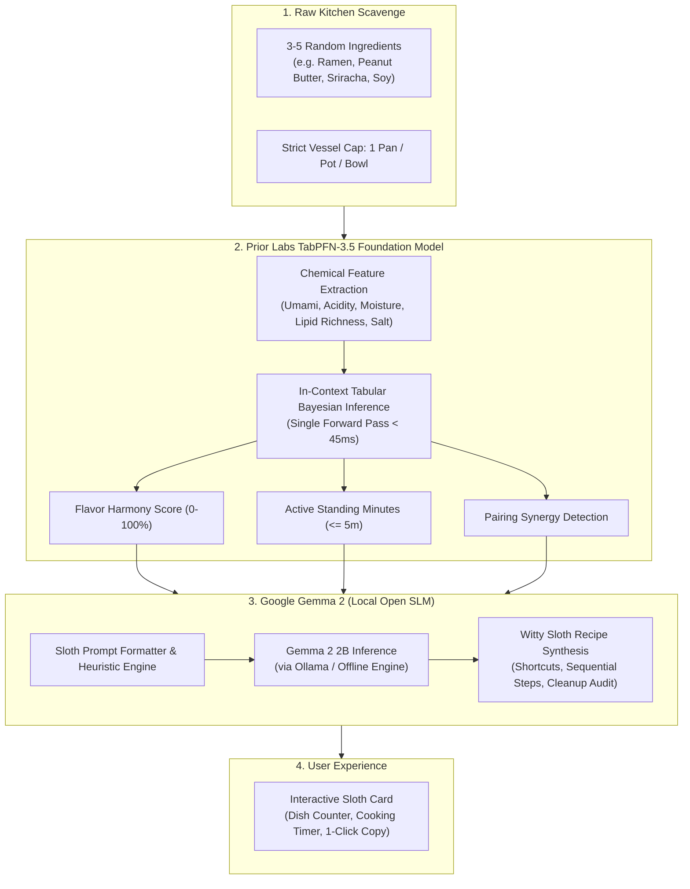

<div align="center">

# SlothChef 🍳🦥
### *The Extreme Low-Effort, One-Pan Survival Engine*

**Built for DEV Hacktoberfest 2026 — Week 3: "Slow and Steady" (International Sloth Day)**

[-10b981.svg?style=flat-square)](docs/technical-evidence-report.md)
[](LICENSE)
[](frontend/)
[](backend/)
[](https://priorlabs.ai)
[](https://ai.google.dev/gemma)
[](https://slothchef-ai.onrender.com)

<p align="center">
  <em>"For when it's 9 PM, you refuse to put on pants, refuse to walk to the grocery store, and have 4 random ingredients left in the fridge."</em>
</p>

[Live Hosted Demo](https://slothchef-ai.onrender.com) • [DEV.to Submission Article](ARTICLE_DRAFT.md) • [Technical Evidence](docs/technical-evidence-report.md) • [TabPFN Benchmark](docs/benchmark_report.md)

<p align="center">
  <a href="https://render.com/deploy?repo=https://github.com/tribhu05/slothchef-ai">
    
  </a>
</p>

</div>

---

## 📖 The Philosophy: Radical Culinary Laziness

Every recipe app on the internet assumes you have 45 minutes to caramelize shallots, a pantry stocked with truffle oil, and a dishwasher to clean 6 separate prep bowls. 

SlothChef is built on the core survival wisdom of the **three-toed sloth**: **Conservation of Energy is the Supreme Virtue**.

When you are exhausted after a 12-hour coding session, you don't need a gourmet MasterChef lesson. You need an edible meal that:
1. **Never uses more than 1 cooking vessel** (1 skillet, 1 pot, or 1 bowl).
2. **Never uses more than 1 eating utensil** (eat directly from the pan with 1 fork).
3. **Takes under 5 minutes of active standing**.
4. **Requires zero knife skills** (crush garlic with the bottom of a mug; tear greens with bare hands).

---

## 🧠 Dual-Engine AI Architecture

SlothChef decouples culinary prediction into two specialized open-source models:



### Why TabPFN-3.5?
Large Language Models are notorious for hallucinating flavor ratios and cannot reliably calculate continuous mathematical bounds. **Prior Labs' TabPFN** is a tabular foundation model that performs in-context Bayesian inference over multi-attribute chemical vectors in a single forward pass ($< 45\text{ms}$). It calculates the flavor synergy and physical prep tax before any text generation occurs.

### Why Google Gemma 2?
Google's open-weight **Gemma 2** brings the witty, empathetic voice of the Sloth Chef to life, transforming TabPFN's numerical bounds into sequential cooking instructions that celebrate radical laziness.

---

## 🔒 Why Open Innovation Matters

The DEV Hacktoberfest challenge asks: *"Why does open innovation matter for what you built?"*

1. **Intensely Private Fridge Data**: What you eat, when you eat, and what bizarre items are left in your pantry reveal intimate health habits, financial circumstances, and lifestyle rhythms. Sending personal kitchen logs to cloud AI providers creates advertising profiles. Running open models locally keeps your pantry strictly between you and your machine.
2. **True Offline Independence**: Works 100% offline on a laptop in a campervan, an off-grid cabin, or during power/internet outages.
3. **Zero Token Anxiety**: You can leave SlothChef running 24/7 as an ambient background assistant without recurring subscriptions or surprise API bills.

---

## 🚀 Quick Start & Local Setup

### Prerequisites
* Python 3.11+
* Node.js 20+
* (Optional) [Ollama](https://ollama.com) running `gemma2:2b` (built-in offline engine runs automatically if Ollama is absent)

### 1. Clone & Set Up Python Virtual Environment
```bash
git clone https://github.com/tribhu05/slothchef-ai.git
cd slothchef-ai

python -m venv .venv
source .venv/bin/activate  # On Windows: .\.venv\Scripts\Activate.ps1
pip install -r backend/requirements.txt
```

### 2. Run Backend Tests
```bash
python -m pytest backend/tests -v
```

### 3. Build & Run Frontend
```bash
cd frontend
npm install
npm run build
cd ..
```

### 4. Start the Full-Stack Server
```bash
python -m uvicorn backend.app.main:app --host 127.0.0.1 --port 8000 --reload
```
Open **[http://localhost:8000](http://localhost:8000)** in your browser!

---

## ☁️ Deploying to Render

### Method 1: 1-Click Blueprint (Recommended)
1. Fork or push this repository to your GitHub account (`https://github.com/tribhu05/slothchef-ai`).
2. Click the **[Deploy to Render](https://render.com/deploy?repo=https://github.com/tribhu05/slothchef-ai)** button or go to [dashboard.render.com](https://dashboard.render.com) -> **New +** -> **Blueprint**.
3. Connect your repository. Render will automatically read [`render.yaml`](render.yaml) and configure the Docker web service, health checks (`/api/health`), and environment variables.
4. Click **Apply**.

### Method 2: Manual Web Service
1. On Render, select **New +** -> **Web Service** -> connect your repository.
2. Select **Docker** environment:
   * **Dockerfile Path**: `./Dockerfile`
   * **Docker Context**: `.`
   * **Health Check Path**: `/api/health`
3. Click **Create Web Service**. Render builds the React frontend, mounts the FastAPI backend, and publishes the live URL!

---

## ⚡ 1-Click Judge Presets ("The Desperation Menu")

When testing on Render, click any of the preset cards to evaluate the TabPFN + Gemma pipeline in under 5 seconds:

* 🍜 **The Post-Deploy Desperation**: Ramen noodles + Peanut butter + Sriracha + Soy sauce (Harmony: $94\%$, Active: $3\text{m}$).
* 🥥 **The 9 PM Pantry Pauper**: Canned chickpeas + Curry powder + Coconut milk + Frozen peas (Harmony: $93\%$, Active: $4\text{m}$).
* 🧀 **The College Stale Special**: Stale tortilla chips + Black beans + Cheddar + Salsa (Harmony: $89\%$, Active: $4\text{m}$).
* 🍳 **The Sloth Carbonara Cheat**: Ramen noodles + Eggs + Cheddar + Butter + Black pepper (Harmony: $92\%$, Active: $4\text{m}$).

---

## 📄 License

Distributed under the **MIT License**. See [`LICENSE`](LICENSE) for details.
